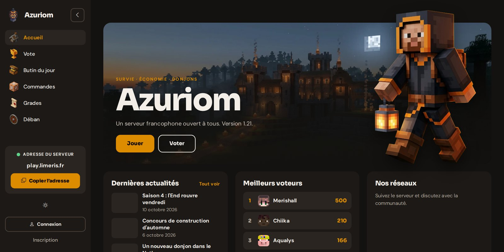
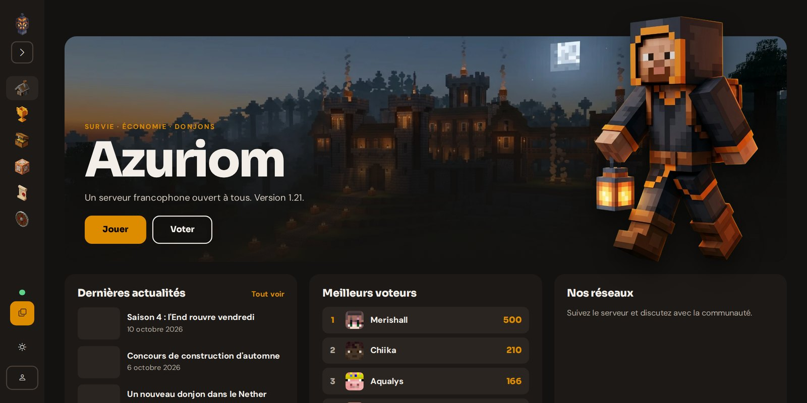
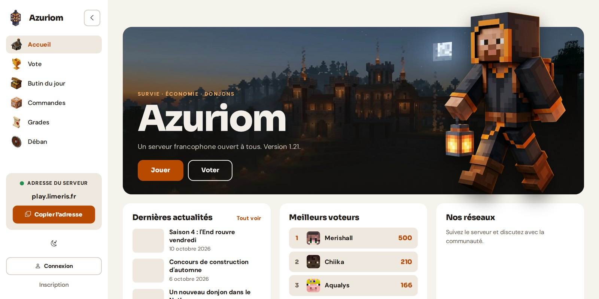
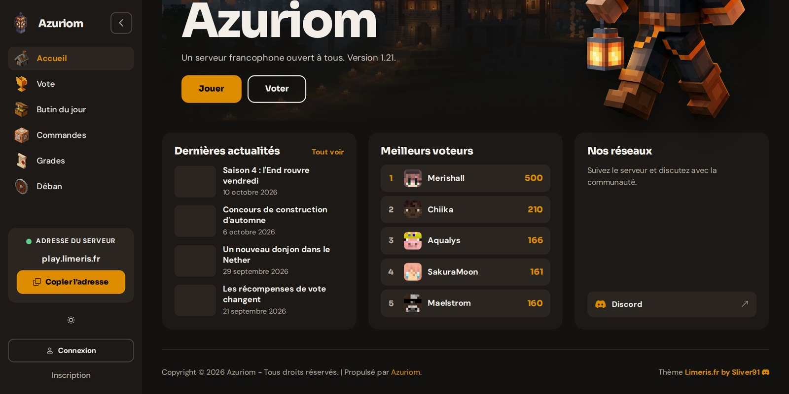
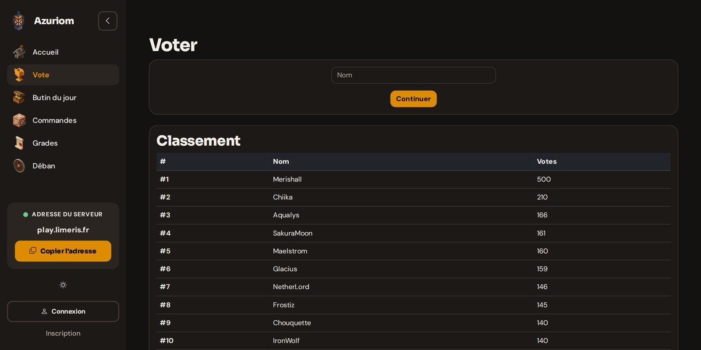
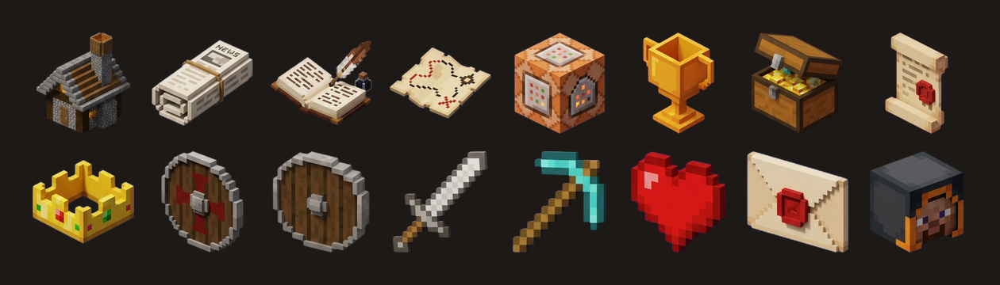

# Lantern

**An animated multi-game theme for [Azuriom](https://azuriom.com)** · Limeris.fr by Sliver91 · [Discord](https://discord.gg/4kV8pgC3Ck) · [limeris.fr](https://limeris.fr)

> **Coming soon on the Azuriom Market.** This repository is a showcase only: it contains no code and no download. Follow the news on [Discord](https://discord.gg/4kV8pgC3Ck).

[Français plus bas](#français)

## Overview

| | |
|---|---|
|  **Menu folded**: icons only, remembered for each visitor |  **Light mode** |
|  **Home page blocks** |  **Plugin pages** follow the same colors |

## Features

- **Multi-game**: Minecraft, Hytale, Garry's Mod, Rust, FiveM, ARK, CS2, s&box. Colors, icons, texts and the "Play" button (copy, Steam, FiveM) follow the game.
- **Animated**: background particles (embers, fireflies, snow, stars), animated header, title effects, blocks appearing on scroll, counters, hover effects. Everything can be turned off.
- **Live editor** for admins: change the look and see it right away.
- **Drag and drop** home page blocks.
- **Fonts, palettes, accent colors**, corners and block styles.
- **Sidebar or top bar**, alignment, width and a highlighted link.
- **Shop**: 3 or 4 items per row, discount badges in the menu and on items, configurable countdown.
- **Custom components** for pages and posts.
- French and English included, light and dark mode, compatible with the official Azuriom plugins.

---

# Français

**Un thème animé multi-jeux pour [Azuriom](https://azuriom.com)** · Limeris.fr by Sliver91 · [Discord](https://discord.gg/4kV8pgC3Ck) · [limeris.fr](https://limeris.fr)

> **Prochainement sur le Market Azuriom.** Ce dépôt sert uniquement de vitrine : il ne contient ni code ni téléchargement. Suivez les nouveautés sur [Discord](https://discord.gg/4kV8pgC3Ck).

## Fonctionnalités

- **Multi-jeux** : Minecraft, Hytale, Garry's Mod, Rust, FiveM, ARK, CS2, s&box. Couleurs, icônes, textes et bouton « Jouer » (copie, Steam, FiveM) suivent le jeu.
- **Animé** : particules en fond (braises, lucioles, neige, étoiles), grand visuel animé, effets sur le titre, blocs qui apparaissent au défilement, compteurs, effets au survol. Tout se désactive.
- **Éditeur en direct** pour les admins : on change l'apparence et on voit le résultat tout de suite.
- **Blocs de l'accueil en glisser-déposer**.
- **Polices, palettes, couleurs d'accent**, coins et style des blocs.
- **Barre latérale ou barre du haut**, alignement, largeur et lien mis en avant.
- **Boutique** : 3 ou 4 articles par ligne, pastilles de réduction dans le menu et sur les articles, compte à rebours réglable.
- **Composants personnalisés** pour les pages et actualités.
- Français et anglais inclus, mode clair et sombre, compatible avec les plugins officiels d'Azuriom.

---

**Limeris.fr by Sliver91** · [Discord](https://discord.gg/4kV8pgC3Ck)
